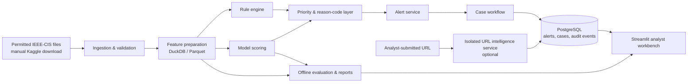
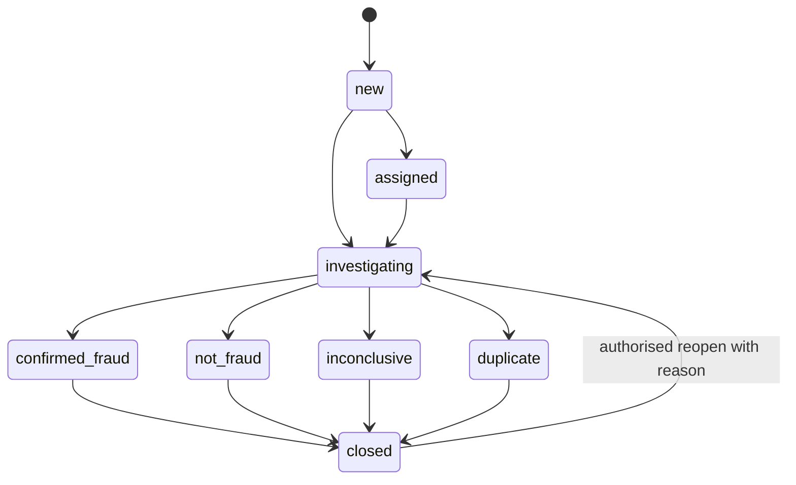

# Tilikra — Technical Design Document (TDD)

| Field | Value |
|---|---|
| Product | Tilikra — Digital Fraud Risk & Investigation Platform |
| Document | Technical Design Document |
| Version | 1.0 |
| Status | Draft for implementation |
| Date | 19 October 2026 |
| Related document | `PRD.md` v1.0 |
| Primary runtime | Local-first; containerised; CPU-only compatible |

---

## 1. Purpose

This document specifies the technical architecture and implementation contracts for Tilikra. It describes components, data flows, schemas, model development and evaluation, API contracts, security controls, testing, observability, and deployment.

Tilikra is a portfolio MVP, not a production payment decisioning system. It demonstrates a production-inspired workflow while explicitly avoiding unvalidated automatic customer-impacting decisions.

## 2. Design Principles

1. **Evidence before claims:** every metric and business assertion must be traceable to a dataset, label definition, evaluation window, and calculation.
2. **Offline-first:** the core product must run locally without paid cloud infrastructure or mandatory third-party APIs.
3. **No restricted data in Git:** source data and derived row-level copies stay in ignored local storage unless terms explicitly allow redistribution.
4. **Point-in-time correctness:** features for a transaction may use only fields that would have been available at scoring time.
5. **Separate data semantics:** original `isFraud` labels, model scores, rule hits, and analyst case outcomes are distinct concepts.
6. **Human decision support:** the system prioritises alerts; it does not execute a decline, block, or recovery action.
7. **Explainability appropriate to data:** coded/anonymised fields are not assigned invented business meanings.
8. **Modular scope:** URL intelligence is a separate bounded context and cannot silently feed the transaction model.
9. **Measured complexity:** add advanced methods only where a baseline comparison demonstrates value.
10. **Reproducibility:** data run, feature definition, split, model artifact, thresholds, and code version are recorded.

## 3. System Context



Important boundary: the URL intelligence context may be associated with a case by a human through a documented reference, but it must not be used as a transaction-model feature unless a defensible linkage key, label definition, and point-in-time availability rule are established and tested.

## 4. Technology Choices

All core application dependencies are free/open-source. Exact versions should be pinned in `pyproject.toml` and a lockfile after compatibility is tested; avoid relying on unpinned floating versions in a reproducible portfolio.

| Layer | Proposed technology | Rationale |
|---|---|---|
| Language | Python 3.11+ | Broad ecosystem; CPU-first support |
| Ingestion / transforms | Polars and/or DuckDB; PyArrow/Parquet | Memory-conscious processing for large CSVs |
| Analytical query | DuckDB | Local analytical SQL without a managed service |
| Data validation | Pandera or explicit schema validators | Reproducible data-quality assertions |
| Model baseline | scikit-learn Logistic Regression | Transparent baseline and reliable evaluation utilities |
| Challenger | LightGBM | Strong tabular model; CPU training is sufficient for an MVP |
| Explainability | SHAP, where compatible and useful | Explanations for model review; not a causal explanation |
| API | FastAPI + Pydantic | Typed request/response schemas and generated OpenAPI docs |
| Operational persistence | PostgreSQL + SQLAlchemy + Alembic | Persist alerts, cases, versions, and event records |
| UI | Streamlit | Low-friction analyst workbench and demonstration |
| Experiments | MLflow local, optional P1 | Record parameters, metrics, and model artifacts without a paid platform |
| Tests | Pytest; HTTPX/TestClient | Unit and API integration tests |
| Quality | Ruff, type checks where practical | Maintainable Python codebase |
| Packaging / runtime | Docker Compose | Repeatable local stack |
| CI | GitHub Actions | Run tests/lint and verify builds without exposing data or secrets |
| Charts | Plotly or Streamlit native charts | Explainable model and operational visualisations |

A public demo may use a free hosting tier for a small, read-only UI, but the architecture must not depend on the continued availability of a free tier. The local Docker path is the reproducible reference implementation.

## 5. Repository Layout

```text
tilikra/
├── README.md
├── PRD.md
├── TDD.md
├── pyproject.toml
├── uv.lock                       # or another committed lockfile
├── .env.example                  # keys are placeholders, no secrets
├── .gitignore
├── docker-compose.yml
├── Dockerfile
├── Makefile
├── configs/
│   ├── rules.yaml
│   ├── model.yaml
│   └── app.yaml
├── docs/
│   ├── architecture.md
│   ├── data_dictionary.md
│   ├── data_governance.md
│   ├── model_card.md
│   ├── evaluation_methodology.md
│   ├── control_mapping_indonesia.md
│   └── adr/
├── data/
│   ├── README.md                 # obtain data; never stores the files in Git
│   ├── raw/                      # gitignored
│   ├── interim/                  # gitignored
│   ├── processed/                # gitignored where source terms require
│   └── reference/                # only explicitly allowed small artefacts
├── artifacts/                    # gitignored model artefacts
├── reports/                       # aggregate reports only; check data terms
├── scripts/
│   ├── validate_data.py
│   ├── prepare_data.py
│   ├── build_features.py
│   ├── train_model.py
│   ├── evaluate_model.py
│   └── batch_score.py
├── src/tilikra/
│   ├── config.py
│   ├── schemas/
│   ├── ingestion/
│   ├── features/
│   ├── rules/
│   ├── models/
│   ├── scoring/
│   ├── alerts/
│   ├── cases/
│   ├── url_intel/                # isolated optional context
│   ├── repositories/
│   ├── api/
│   └── services/
├── app/
│   └── streamlit_app.py
└── tests/
    ├── unit/
    ├── integration/
    ├── contract/
    └── fixtures/                 # tiny synthetic fixtures for software tests only
```

Synthetic fixtures may be used solely to test validation and workflow logic. They must never be mixed with training/evaluation datasets or presented as empirical benchmark results. The model benchmark must use the documented real dataset only.

## 6. Data Ingestion and Governance

### 6.1 Primary Dataset

Source: https://www.kaggle.com/competitions/ieee-fraud-detection/data

Files are obtained directly by the user from Kaggle after accepting the current competition terms. Expected files include `train_transaction.csv`, `train_identity.csv`, `test_transaction.csv`, `test_identity.csv`, and `sample_submission.csv`.

The source dataset is about 1.35 GB and subject to competition rules. It must not be described as unrestricted open data. No raw files, local copies, split copies, or derived row-level data should be committed to the repository. Before publishing any model artifact or dataset-derived export, verify that the current terms permit that use.

### 6.2 Required Ingestion Checks

- Expected file existence and non-zero size.
- Required columns and expected primary key (`TransactionID`).
- Unique transaction key within each transaction table.
- Identity join coverage and join cardinality; identity records are optional for some transactions.
- Duplicate rows / duplicate transaction IDs.
- Missingness by column and by time range.
- Target availability and class prevalence only for the training split.
- Numeric ranges and categorical cardinality profiles.
- `TransactionDT` monotonicity profile and range; document that it is a relative time delta rather than a calendar timestamp.
- A manifest containing source, acquisition instructions, input checksums where safe, row counts, schema fingerprint, code revision, and preparation timestamp. Do not put dataset content in the manifest.

### 6.3 Data Layers

- **Raw:** user-acquired source files, read-only, ignored by Git.
- **Interim:** parsed, key-validated, joined or partitioned intermediate data; ignored by Git.
- **Processed:** model-ready feature tables and split manifest; ignored by Git if derived data remains subject to the source rules.
- **Serving records:** prediction/alert/case metadata persisted in PostgreSQL. Do not persist full training rows by default; retain only permitted feature snapshots / necessary reference values and include an explicit data-retention policy.

### 6.4 Feature Availability and Leakage

The feature pipeline must distinguish:

- source attributes available at transaction evaluation;
- aggregates that can be computed from prior records only;
- post-event or investigation information that must not be used as a model feature;
- identifiers useful for joins or validation but not necessarily suitable as predictive features.

No aggregate may use future transactions relative to the scored event. Any historical/velocity feature must be built using a strictly prior window or a documented offline approximation. Fit all learned preprocessing on the training split only. The holdout test set must not influence feature selection, model selection, or threshold choice.

Since `TransactionDT` is a relative time delta, split by ordered ranges of this field instead of pretending that it is a calendar timestamp. Select split boundaries only after auditing row counts, event order, and label prevalence. Use separate training, validation/threshold-selection, and final holdout windows. Preserve and document each record ID set or deterministic split manifest locally; do not publish restricted row-level ID lists unless terms permit.

### 6.5 Data Dictionary

Each field must be classified as one of:

- **Documented business/technical field:** meaning is supplied by the source.
- **Coded/anonymised field:** name/value semantics are limited or masked.
- **Derived field:** created by Tilikra with a formula, availability timestamp, and version.
- **Operational field:** generated by the application (score, rule hit, case status).

Do not assign business meanings to anonymised `V*`, `C*`, `D*`, or other coded fields without a reliable source.

## 7. Detection Architecture

### 7.1 Three Independent Signal Types

1. **Rules:** deterministic and versioned; each rule returns a rule ID, version, outcome, and human-readable rationale.
2. **Model score:** score from a versioned supervised classifier; retain its probability interpretation only if calibration is evaluated.
3. **Optional anomaly score:** a separate exploratory signal. It is not a fraud label and is not required for the initial MVP.

The decision layer may rank alerts based on configured values but must retain the underlying signals separately. Do not irreversibly collapse all signals into one unexplained number.

### 7.2 Baseline and Challenger

- Baseline: Logistic Regression with an appropriate preprocessing pipeline.
- Challenger: LightGBM on the same split and a comparable feature availability policy.
- Optional: Isolation Forest for anomaly-ranking experiments only.
- Optional: SHAP for local/global explanation where appropriate.

Use class weights or sampling only after defining the evaluation procedure. If training resampling is applied, it must occur only inside the training process and never before splitting; holdout prevalence must remain untouched. Avoid presenting a resampled test set as real-world performance.

### 7.3 Metrics and Threshold Selection

Primary: Average Precision / PR-AUC. Secondary: precision, recall, ROC-AUC, confusion matrix at explicit thresholds. Operational ranking: Precision@K and Recall@K for stated K values. Calibration: Brier score or reliability plot if probabilities inform a decision scenario.

Threshold selection occurs on the validation/threshold-selection window. The final holdout is used once for reporting. The report must include positive prevalence, selected threshold, and confidence caveats. Thresholds are illustrative policy scenarios—not production prescriptions.

### 7.4 Rule Evaluation

Rule definitions live in versioned YAML or Python functions with unit tests. The report compares:

- rule-only results;
- model-only results;
- combined priority ranking.

For each rule, record its rationale, inputs, version, expected direction, test coverage, and known false-positive modes. Do not assign rules to coded fields unless the rule is framed as a generic statistical pattern rather than a claim about a real-world attribute.

## 8. Logical Data Model

Operational persistence uses PostgreSQL. Analytical/model data use Parquet and DuckDB. This avoids forcing large offline feature-generation jobs through the transactional application database.

### 8.1 Core Entities

- `dataset_runs`: metadata for each locally prepared/evaluated dataset run.
- `model_versions`: model artifact metadata, code/data split reference, feature schema hash, metrics, and approval status.
- `score_runs`: one batch/API scoring invocation.
- `transaction_scores`: score output and rule signals for an available source transaction.
- `alerts`: item prioritised for analyst review.
- `cases`: case-management record linked to one or more alerts.
- `case_events`: append-only event history for case status changes and comments.
- `rule_definitions`: versioned rule metadata; implementation config remains source-controlled.
- `url_indicator_checks`: separate URL investigation results, not transaction-model features by default.

### 8.2 Suggested PostgreSQL Schema

The following is logical starter DDL. Production migrations should be managed by Alembic and may refine constraints after implementation.

```sql
CREATE TABLE dataset_runs (
    id UUID PRIMARY KEY,
    source_name TEXT NOT NULL,
    source_version TEXT,
    source_terms_reference TEXT NOT NULL,
    schema_fingerprint TEXT NOT NULL,
    code_revision TEXT NOT NULL,
    row_count BIGINT,
    started_at TIMESTAMPTZ NOT NULL,
    completed_at TIMESTAMPTZ,
    status TEXT NOT NULL CHECK (status IN ('running','succeeded','failed')),
    quality_report JSONB NOT NULL DEFAULT '{}'::jsonb
);

CREATE TABLE model_versions (
    id UUID PRIMARY KEY,
    model_name TEXT NOT NULL,
    model_version TEXT NOT NULL,
    dataset_run_id UUID REFERENCES dataset_runs(id),
    feature_schema_hash TEXT NOT NULL,
    artifact_uri TEXT NOT NULL,
    metrics JSONB NOT NULL DEFAULT '{}'::jsonb,
    parameters JSONB NOT NULL DEFAULT '{}'::jsonb,
    code_revision TEXT NOT NULL,
    evaluation_split_ref TEXT NOT NULL,
    status TEXT NOT NULL CHECK (status IN ('candidate','validated','retired')),
    created_at TIMESTAMPTZ NOT NULL DEFAULT now(),
    UNIQUE (model_name, model_version)
);

CREATE TABLE score_runs (
    id UUID PRIMARY KEY,
    model_version_id UUID REFERENCES model_versions(id),
    dataset_run_id UUID REFERENCES dataset_runs(id),
    run_mode TEXT NOT NULL CHECK (run_mode IN ('batch','api_demo')),
    started_at TIMESTAMPTZ NOT NULL,
    completed_at TIMESTAMPTZ,
    status TEXT NOT NULL CHECK (status IN ('running','succeeded','failed')),
    parameters JSONB NOT NULL DEFAULT '{}'::jsonb
);

CREATE TABLE transaction_scores (
    id UUID PRIMARY KEY,
    source_name TEXT NOT NULL,
    source_transaction_ref TEXT NOT NULL,
    score_run_id UUID NOT NULL REFERENCES score_runs(id),
    model_version_id UUID REFERENCES model_versions(id),
    risk_score DOUBLE PRECISION,
    score_type TEXT NOT NULL CHECK (score_type IN ('probability','ranking_score')),
    score_reasons JSONB NOT NULL DEFAULT '[]'::jsonb,
    rule_results JSONB NOT NULL DEFAULT '[]'::jsonb,
    scored_at TIMESTAMPTZ NOT NULL DEFAULT now(),
    UNIQUE (source_name, source_transaction_ref, score_run_id)
);

CREATE TABLE alerts (
    id UUID PRIMARY KEY,
    transaction_score_id UUID REFERENCES transaction_scores(id),
    priority TEXT NOT NULL CHECK (priority IN ('critical','high','medium','low','unrated')),
    status TEXT NOT NULL CHECK (status IN ('new','assigned','in_review','closed')),
    reason_summary TEXT NOT NULL,
    created_at TIMESTAMPTZ NOT NULL DEFAULT now(),
    assigned_to TEXT,
    closed_at TIMESTAMPTZ
);

CREATE TABLE cases (
    id UUID PRIMARY KEY,
    title TEXT NOT NULL,
    status TEXT NOT NULL CHECK (status IN ('new','assigned','investigating','confirmed_fraud','not_fraud','inconclusive','duplicate','closed')),
    outcome TEXT CHECK (outcome IN ('confirmed_fraud','not_fraud','inconclusive','duplicate')),
    owner TEXT,
    created_at TIMESTAMPTZ NOT NULL DEFAULT now(),
    updated_at TIMESTAMPTZ NOT NULL DEFAULT now(),
    closed_at TIMESTAMPTZ
);

CREATE TABLE case_alert_links (
    case_id UUID NOT NULL REFERENCES cases(id),
    alert_id UUID NOT NULL REFERENCES alerts(id),
    linked_at TIMESTAMPTZ NOT NULL DEFAULT now(),
    PRIMARY KEY (case_id, alert_id)
);

CREATE TABLE case_events (
    id UUID PRIMARY KEY,
    case_id UUID NOT NULL REFERENCES cases(id),
    actor_id TEXT NOT NULL,
    event_type TEXT NOT NULL,
    from_status TEXT,
    to_status TEXT,
    note TEXT,
    evidence_refs JSONB NOT NULL DEFAULT '[]'::jsonb,
    occurred_at TIMESTAMPTZ NOT NULL DEFAULT now()
);

CREATE TABLE url_indicator_checks (
    id UUID PRIMARY KEY,
    submitted_url_hash TEXT NOT NULL,
    parsed_hostname TEXT,
    check_type TEXT NOT NULL,
    provider_name TEXT,
    provider_result JSONB NOT NULL DEFAULT '{}'::jsonb,
    model_version TEXT,
    checked_at TIMESTAMPTZ NOT NULL DEFAULT now(),
    linked_case_id UUID REFERENCES cases(id)
);
```

`source_transaction_ref` should be an opaque source identifier (for example, the dataset's transaction ID), not a direct identifier of a real customer. If an external source ID is not permitted to be stored in a published artifact, it must stay local. Avoid persisting a full transaction row in Postgres by default.

### 8.3 Indexes

Add indexes on `alerts(status, priority, created_at)`, `cases(status, updated_at)`, `transaction_scores(score_run_id, risk_score DESC)`, `case_events(case_id, occurred_at)`, and `case_alert_links(alert_id)`. Index `source_transaction_ref` only where it is needed for lookup and allowed by the source terms.

## 9. API Design

All endpoints are under `/api/v1`. Pydantic schemas must reject invalid types and unexpected payload sizes. Responses include a request/correlation ID. Raw training rows are not exposed through the public API.

### 9.1 Health and metadata

- `GET /health/live` — process liveness.
- `GET /health/ready` — readiness, including model availability and database state.
- `GET /api/v1/models/active` — active model/version metadata without exposing restricted data.

### 9.2 Transaction scoring

`POST /api/v1/score`

Request (conceptual):

```json
{
  "source_name": "ieee_cis_demo",
  "source_transaction_ref": "<locally-permitted-reference>",
  "features": { "<approved_feature_name>": "<value>" },
  "mode": "decision_support"
}
```

Response (conceptual):

```json
{
  "score_id": "<uuid>",
  "score": 0.82,
  "score_type": "probability",
  "model_version": "lightgbm-<version>",
  "triggered_rules": ["RULE-<id>"],
  "reason_codes": ["<reason-code>"],
  "priority": "high",
  "decision_notice": "Review recommendation only; no automatic transaction action was taken."
}
```

Values above are illustrative response examples, not expected performance. The service must not accept arbitrary column sets and pass them unchecked to a model. It validates against a versioned feature schema and uses server-side preprocessing. If raw arbitrary feature scoring is not available because the model's feature contract is too complex, the first MVP should expose a batch-scoring endpoint over approved source references and reserve per-record scoring for a later iteration.

### 9.3 Alerts

- `GET /api/v1/alerts` — paginated alert queue, filterable by status, priority, model version, and dates available in application metadata.
- `GET /api/v1/alerts/{alert_id}` — alert detail including score, rules, provenance, and related case links.
- `POST /api/v1/alerts/{alert_id}/cases` — create a case from an alert or attach it to an existing case.

### 9.4 Cases

- `GET /api/v1/cases/{case_id}` — case details and event history.
- `POST /api/v1/cases` — create case with title and linked alert IDs.
- `PATCH /api/v1/cases/{case_id}` — owner or supported status transition update; every state change creates a case event.
- `POST /api/v1/cases/{case_id}/events` — append note/evidence reference.
- `POST /api/v1/cases/{case_id}/close` — close with a mandatory outcome reason.

### 9.5 URL intelligence (isolated optional module)

- `POST /api/v1/url-checks` — validate and parse URL string, then run the local model and/or configured provider adapter.
- `GET /api/v1/url-checks/{check_id}` — return provider/model findings with timestamp and provenance.

Security constraints: never navigate to the submitted URL, never resolve it as an instruction to fetch arbitrary content, and never allow it to choose a provider URL. Provider calls must use fixed, configured HTTPS endpoints. Do not expose API keys in client code.

## 10. Case State Machine and Audit

Allowed transitions should be explicit and enforced by the service layer, not only the UI.



Every transition records actor, time, previous state, new state, and reason. In the portfolio demo, actor identities may be local demo users, but records must still show who performed each action. Case outcomes are analyst workflow outcomes, not the original dataset target and not legal determinations.

## 11. Rule Configuration

Each rule definition should contain:

```yaml
rule_id: RULE-EXAMPLE-001
version: 1
enabled: false
name: Example rule placeholder
purpose: Explain the risk hypothesis and intended investigation outcome.
inputs: []
condition: "implemented in a tested Python function or typed expression"
severity: medium
reason_code: EXAMPLE_SIGNAL
limitations:
  - This is a portfolio rule and has not been calibrated to Indonesian live traffic.
```

Do not activate a placeholder as though it were an empirically validated production rule. Actual rule definitions must be supported by the available features, tests, and evaluation results. Store rule configuration under version control; persist the applied rule version in each score result.

## 12. Model Training and Evaluation Pipeline

### 12.1 Pipeline Stages

1. Verify source files and record manifest.
2. Validate schema, key uniqueness, join coverage, and label availability.
3. Generate a time-aware split using ordered `TransactionDT` windows.
4. Build features with point-in-time availability rules.
5. Fit preprocessing and baseline model using training data only.
6. Fit the challenger model using the same split and comparable feature scope.
7. Select thresholds on the validation window.
8. Evaluate once on final holdout.
9. Generate aggregate report and model card.
10. Register local artifact metadata, feature schema hash, split reference, metrics, and code revision.

### 12.2 Feature Groups

- **Documented transaction features:** use their documented meanings.
- **Identity/device-like fields:** keep semantics as coded where anonymised; check missingness and point-in-time availability.
- **Historical aggregations:** only use records available before the scored transaction, where the source structure supports such reconstruction.
- **Identifiers:** use for joining and leakage-safe split checks only unless predictive use is justified and evaluated.
- **Excluded features:** target `isFraud` from the inference feature matrix, any post-label field, any holdout-derived statistic, and any field whose availability time is not defensible.

### 12.3 Evaluation Outputs

Required aggregate outputs:

- split row counts and target prevalence;
- data-quality report;
- baseline/challenger metrics;
- precision-recall curve and selected thresholds;
- confusion matrix at explicit thresholds;
- precision@K / recall@K for stated K values;
- calibration report if probabilities are operationally interpreted;
- error analysis by time and selected available feature slices;
- feature importance or SHAP report with limitations;
- model card with intended use and prohibited claims.

Do not publish restricted row-level outputs or transaction references. Publish aggregate metrics only after checking source restrictions.

## 13. URL Intelligence Adapter

The optional module has a separate lifecycle and schema from transaction scoring.

- Use UCI PhiUSIIL (CC BY 4.0) for model development if the module is implemented.
- For a model intended to operate on URL strings without fetching a webpage, build features from the raw URL string only. Exclude webpage-derived features unless a safe, controlled capture pipeline is deliberately implemented and separately threat-modelled.
- Attribute the dataset source in documentation and any derived publication.
- A URLhaus integration must comply with current API authentication and fair-use terms.
- Persist only required indicators, source, timestamp, and result; avoid mass replication of external feeds.
- Never treat a phishing URL classification as evidence that an IEEE-CIS transaction was caused by that URL.

## 14. Application Security

Threat model scope: a public-facing or locally hosted demo with analyst-supplied inputs and restricted source data.

Controls:

- No automatic visiting/fetching of user-submitted URLs (SSRF protection by design).
- Pydantic schema validation and request-size limits.
- Rate limiting for public demo endpoints where supported by the hosting environment.
- Secrets exclusively through environment variables or host secret storage; `.env` ignored by Git.
- No raw dataset rows in logs; redact long free-text notes and query strings where practical.
- Read-only default mode for public demonstrations; disable case mutation unless authentication or an explicitly controlled demo mode is configured.
- Use parameterised database access through SQLAlchemy; no dynamic SQL from user input.
- CORS allowlist rather than wildcard origins for any browser-accessible API.
- Dependency lockfile and automated dependency/security checks where available.
- No credentials, customer PII, or real case notes in demo data.

This is not a production security certification. Any real financial institution deployment would require identity federation, role-based access, secrets management, audit retention, incident response, threat modelling, and formal security review.

## 15. Observability and Model Monitoring

Application telemetry (measured by Tilikra):

- request count, errors, and latency by endpoint;
- scoring failures and model load failures;
- alert creation and case workflow counts;
- status-transition and case-closure time intervals;
- data validation failures per pipeline run.

Model/data monitoring (where new data is available):

- schema and missingness drift;
- distribution summaries for selected features;
- score distribution changes;
- rule firing rates;
- label-based metrics only when sufficiently mature labels exist.

Do not claim production drift detection on a static competition dataset. For the portfolio, run a reproducible comparison across time windows and label it as offline monitoring. Avoid automatically retraining a model from unreviewed case outcomes.

## 16. Testing Strategy

### Unit Tests

- Data schema and key validation.
- Transaction/identity join cardinality.
- Feature generation and strict point-in-time rules.
- Rule outcomes and reason-code consistency.
- Model feature schema checks and deterministic preprocessing.
- Threshold and metric calculations against small, explicitly synthetic software-test fixtures.
- Case transition validation and audit-event creation.
- URL parser rejects malformed input without making outbound requests.

### Integration Tests

- Data preparation on a permitted small sample or local fixture.
- Train/inference feature-schema parity.
- FastAPI scoring and response contract.
- Database persistence for alerts, cases, and events.
- Streamlit/API integration against a local service.
- Container startup/readiness and migration execution.

### Regression Tests

- Freeze expected aggregate values on a tiny software-test fixture, not on an unlicensed public output sample.
- Assert metric calculations and event transitions remain stable.
- Do not freeze a model performance expectation until a reproducible baseline experiment has been run; report measured values in the model card.

### End-to-End Acceptance Test

1. Run data validation.
2. Prepare features and time-aware split.
3. Train baseline and challenger.
4. Generate final holdout evaluation report.
5. Launch the local stack with Docker Compose.
6. Run a batch score on a permitted local sample.
7. Open an alert and create a case.
8. Add a note, change status, close with outcome, and verify event history.
9. Confirm dashboard values match persisted application state.
10. Verify the public Git working tree contains no raw data, secrets, or restricted per-record exports.

## 17. Resource and Deployment Profiles

### Profile A — Laptop / CPU only

- Use DuckDB and Polars for preparation.
- Keep full raw files on local disk, not in containers or Git.
- Train LightGBM on a reduced, documented training-time subset if resource constrained; do not silently change the benchmark split. Also keep a full-data path for Colab/Kaggle if needed.
- Run Streamlit, FastAPI, and Postgres using Docker Compose; an offline single-process mode can be provided if Postgres is too heavy.

### Profile B — Google Colab / Kaggle for training

- Download data through the permitted platform interface.
- Save only permitted model artifacts and aggregate reports to a location allowed by current terms.
- Record the runtime, seed, package lock, split method, and parameters.
- Do not publish raw dataset or identity-linked rows.

### Profile C — Public demo

- Use a read-only sample / approved CC BY 4.0 URL module or precomputed aggregate results whose publication is permitted.
- Do not make public demo dependent on private Kaggle files being present on the host.
- Keep live third-party API integration optional, server-side, and rate-limited.
- Provide a local Docker demo for complete reproduction even if the free hosting tier sleeps or becomes unavailable.

## 18. CI/CD and Code Quality

On each pull request / push:

1. Install dependencies from lockfile.
2. Run Ruff and available type checks.
3. Run unit and contract tests.
4. Run API integration tests against service fixtures.
5. Build the Docker image.
6. Scan the repository for committed `.env`, API keys, and large raw-data files.

Model training on the full dataset is not required for every CI run. CI validates code and software contracts. Full model experiments run manually or through an explicitly triggered workflow where data access permissions are already satisfied.

## 19. Failure Handling

- **Missing data files:** stop early with actionable instructions; do not silently create substitute data.
- **Schema drift:** mark the run failed or quarantined; do not score with an incompatible feature schema.
- **Model artefact missing:** readiness fails and scoring returns a controlled service error.
- **Database unavailable:** scoring may run only in an explicitly configured offline batch mode; never pretend case persistence succeeded.
- **External URL-intelligence provider unavailable:** return `provider_unavailable` and preserve local model output; no false claim of live threat verification.
- **Unseen/invalid categorical value:** use a tested unknown-category pathway or reject based on the feature contract; log aggregate counts without exposing sensitive raw strings.

## 20. Architecture Decision Records (ADRs)

### ADR-001 — Offline-first pipeline

**Decision:** use Parquet + DuckDB/Polars for analytical processing and PostgreSQL for application workflow data.

**Reason:** large offline tables are better suited to columnar processing; application persistence has different access patterns.

**Trade-off:** two storage systems require documented data boundaries.

### ADR-002 — Rule + model, not model-only

**Decision:** retain rules and ML as separately recorded signals.

**Reason:** reason codes and rule outcomes are easier to review; model lift can be measured against a baseline.

**Trade-off:** the combined priority policy must be validated and explained rather than assumed to be optimal.

### ADR-003 — No automatic transaction action

**Decision:** the MVP recommends investigation priority only.

**Reason:** dataset context is not a production bank environment; there is no authority, live integration, or Indonesian operational validation.

**Trade-off:** the portfolio demonstrates decision support, not an end-to-end payment intervention.

### ADR-004 — URL intelligence is isolated

**Decision:** URL checks use separate endpoints/tables and do not feed transaction model features by default.

**Reason:** the selected datasets have no trustworthy join key.

**Trade-off:** the URL module demonstrates extensibility rather than improving the transaction model.

### ADR-005 — No public dataset redistribution

**Decision:** the repository includes instructions and code but no IEEE-CIS raw files.

**Reason:** dataset use is subject to Kaggle competition rules.

**Trade-off:** reviewers must obtain access and download data separately to reproduce full experiments.

## 21. Definition of Done

The technical MVP is done when:

- the local pipeline is reproducible from the documented source files;
- schema, keys, data quality, and time split are auditable;
- baseline and challenger models are evaluated without holdout leakage;
- model artefact metadata captures version, data run, feature schema, code revision, and metrics;
- API responses validate against documented schemas;
- alerts and cases are persisted and all case transitions create immutable event records;
- dashboard calculations can be traced to definitions and underlying operational data;
- URL intelligence remains isolated and does not fetch arbitrary user URLs;
- automated checks pass and Docker startup is documented;
- no raw restricted data or secrets are committed;
- limitations and Indonesian external-validity caveats are stated prominently.

## 22. References

- IEEE-CIS Fraud Detection dataset and competition rules: https://www.kaggle.com/competitions/ieee-fraud-detection/data
- IEEE-CIS dataset description (`TransactionDT`, train/test files, fields): https://www.kaggle.com/c/ieee-fraud-detection/data?select=train_identity.csv
- UCI PhiUSIIL Phishing URL Dataset and CC BY 4.0 licence: https://archive.ics.uci.edu/dataset/967/phiusil-phishing-url-dataset
- OJK POJK No. 12 Tahun 2024: https://www.ojk.go.id/en/regulasi/Pages/12-Tahun-2024-Penerapan-Strategi-Anti-Fraud-bagi-Lembaga-Jasa-Keuangan.aspx
- URLhaus API terms/documentation: https://urlhaus.abuse.ch/api/
- FastAPI documentation: https://fastapi.tiangolo.com/
- DuckDB documentation: https://duckdb.org/docs/
- LightGBM documentation: https://lightgbm.readthedocs.io/
- scikit-learn model evaluation: https://scikit-learn.org/stable/modules/model_evaluation.html
